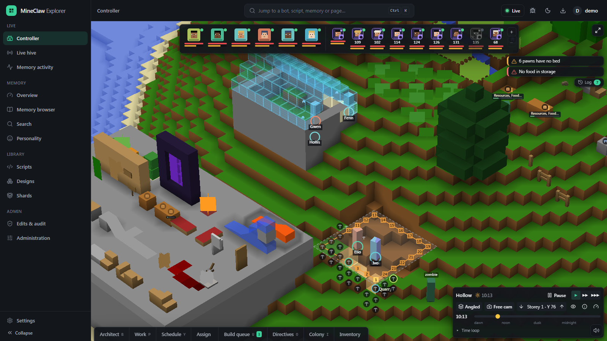
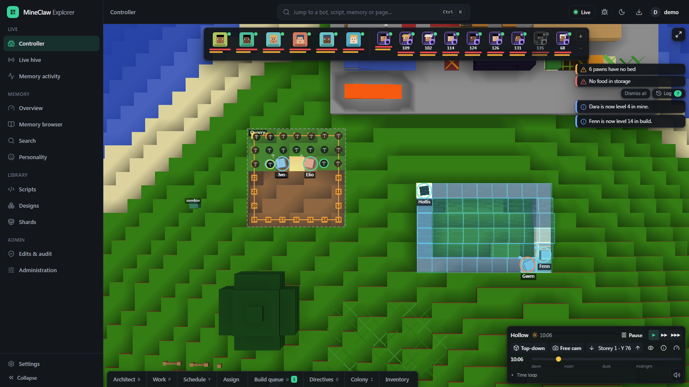
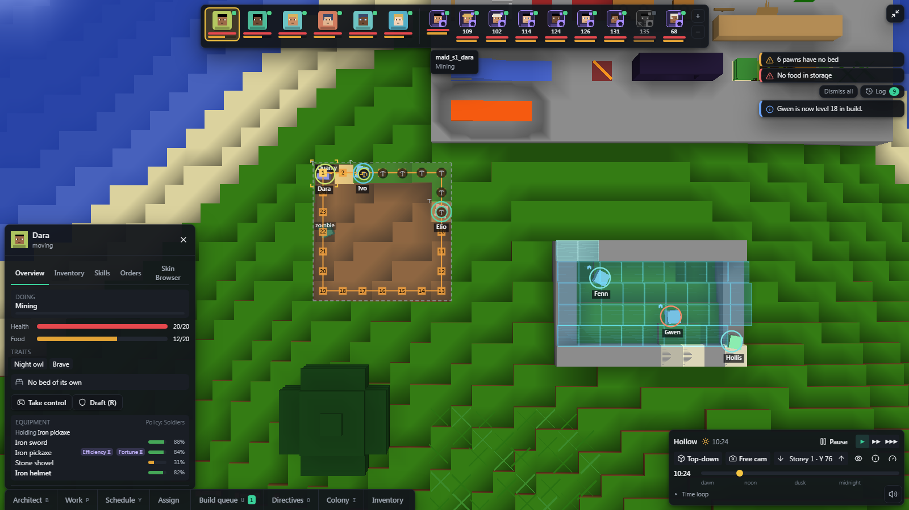
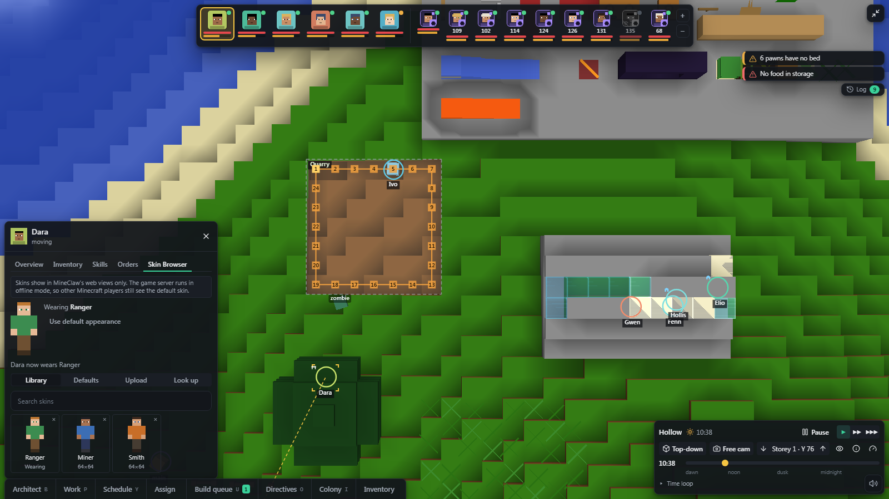
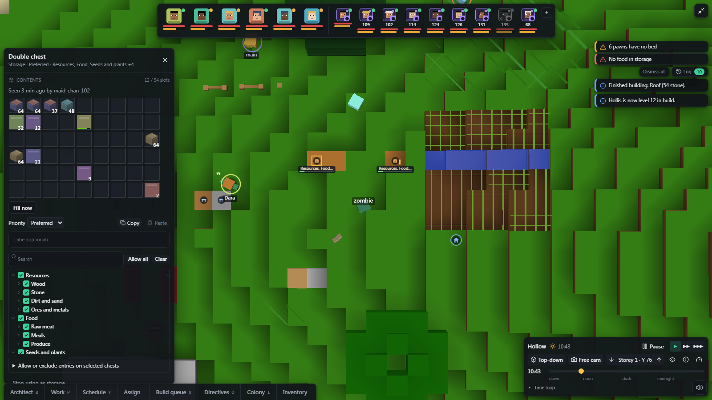
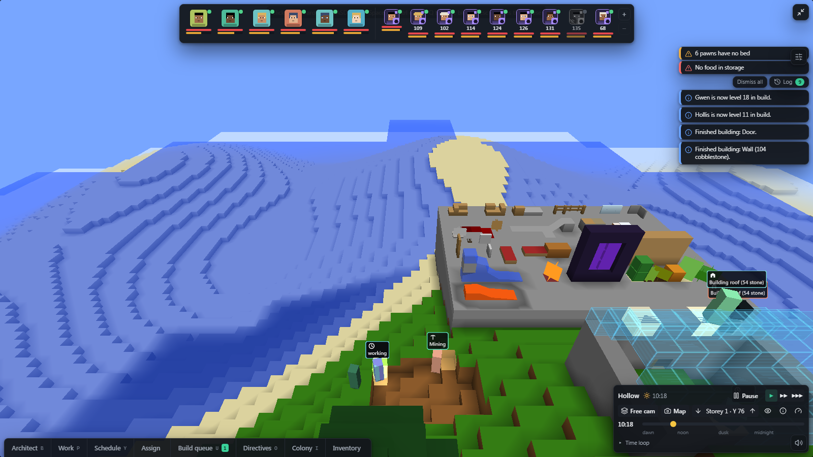
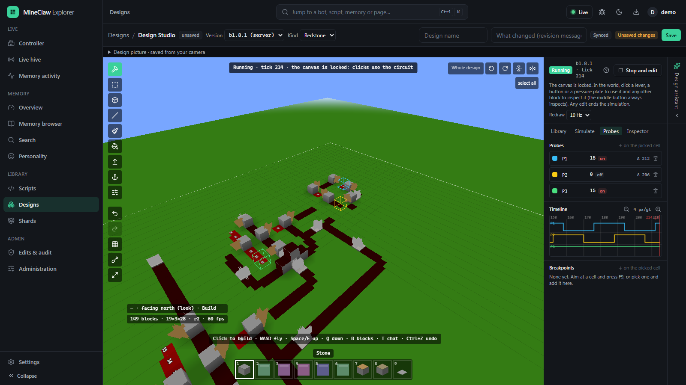
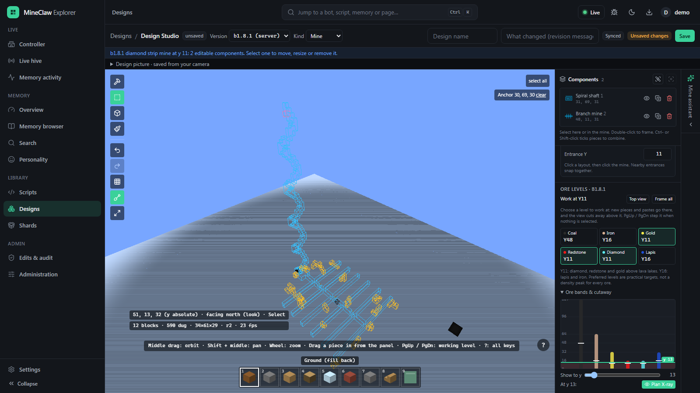
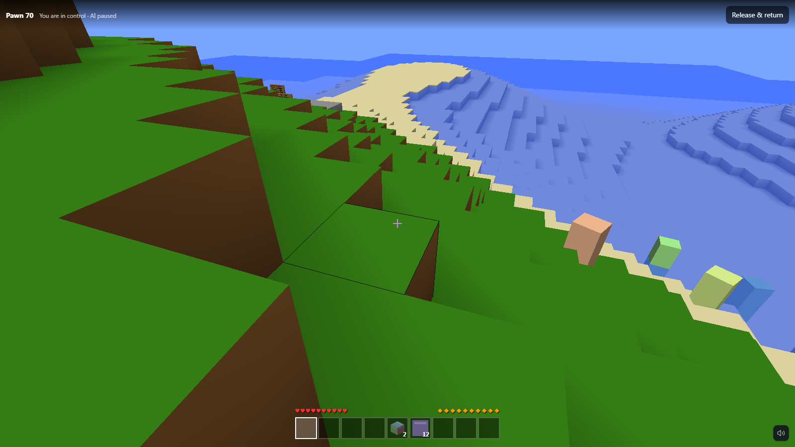
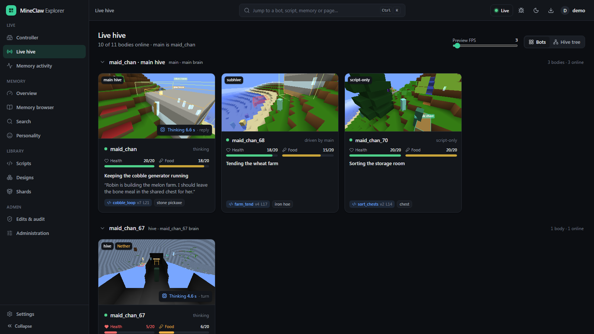

<h1 align="center">MineClaw</h1>

<p align="center">
  <b>AI-run Minecraft bots and a colony you command from the browser.</b><br>
  A from-scratch Minecraft client in C#, LLM "hive minds" that play and chat alongside people, and a web Controller
  where you mark work, design builds and mines, debug redstone, or take over a bot yourself.
</p>

<p align="center">
  <a href="LICENSE"></a>
  
  
  
</p>

<p align="center">
  
</p>

MineClaw bots join ordinary Minecraft servers as players. A language model plans and talks while C# does the playing,
so the model is never on the per-tick path. Run a single helper that chats and takes requests, a whole hive of bodies
sharing one brain, or a Story Mode colony: script-driven pawns with jobs, schedules, storage and a build queue, run by a
colony director and steered from the web Controller.

It is free and open source under the [MIT License](LICENSE).

## Highlights

- **Its own Minecraft client.** Protocol, world and inventory state, physics, pathfinding, digging, building, crafting,
  combat and survival for Java **Beta 1.8.1** (protocol 17) and **1.12.2** (protocol 340), written from scratch in C#.
- **Hive minds.** An LLM brain (Anthropic models by default, Ollama optional) drives one or many bodies, spawns clone
  hives and subhives, and writes scripts that bodies run without a model. Memory lives in SQLite with hybrid search and
  a RAPTOR tree.
- **Story Mode.** A colony manager in the browser: mark trees, quarries and builds, set work priorities and schedules,
  draft pawns, fill storage, and watch the colony get on with it.
- **Design Studio.** Draw builds, plan mines over generated terrain, and build redstone with a tick-accurate simulator
  and debugger. The AI can co-design, and pawns can build or dig the saved designs.
- **Web Controller.** Next.js + NestJS with a three.js world viewer, live bot views, chat as a signed-in player, memory
  and script explorers, sign-in with roles and an audit log.

## A tour of the Controller

> These screenshots come from the web app's built-in demo mode, which draws the world in flat colours. With your own
> game files imported (see [Minecraft game assets](#minecraft-game-assets)) the viewer uses the real textures.

### Colony Controller

Mark the work and the pawns pick it up: here two of them dig a quarry, its stair numbered round the edge, while the rest
raise a workshop from its build holograms. Alerts, the colonist bar and the clock sit around the map.



<table>
  <tr>
    <td width="50%" valign="top">
      
      <p><b>Pawn inspector.</b> What a pawn is doing and why, its needs, traits and gear, with one-click Take control
      and Draft.</p>
    </td>
    <td width="50%" valign="top">
      
      <p><b>Skin Browser.</b> Give each pawn a look: upload a skin, look one up, or reuse the shared library. Skins show
      in MineClaw's own views.</p>
    </td>
  </tr>
  <tr>
    <td width="50%" valign="top">
      
      <p><b>Storage.</b> Click a chest to see what is in it, set its priority and choose what it accepts from a filter
      tree.</p>
    </td>
    <td width="50%" valign="top">
      
      <p><b>3D world viewer.</b> Switch from the map to a free camera and fly over the colony while it works.</p>
    </td>
  </tr>
</table>

### Design Studio

<table>
  <tr>
    <td width="50%" valign="top">
      
      <p><b>Redstone designer and debugger.</b> Drop in proven gates, run the tick-accurate simulator, and probe any cell
      to see its signal on a timeline. Step ticks, set breakpoints, inspect what powers a block.</p>
    </td>
    <td width="50%" valign="top">
      
      <p><b>Mine designer.</b> Plan shafts and strip mines over generated terrain, cut the view away at an ore level, and
      see which veins the tunnels expose and what the dig will yield.</p>
    </td>
  </tr>
</table>

### Live bots

<table>
  <tr>
    <td width="50%" valign="top">
      
      <p><b>Hand control.</b> Take over any pawn in first person: move, mine and build with its hotbar while its AI waits,
      then hand it back.</p>
    </td>
    <td width="50%" valign="top">
      
      <p><b>Live hive.</b> Every body grouped by hive, each with a live view, its task, its thoughts and the script it is
      running.</p>
    </td>
  </tr>
</table>

## Quick start

**Install a release.** Docker compose, a Linux service (systemd) or a Helm chart, each in one command; you finish the
setup in the browser.

<!-- PLACEHOLDER: docs/install.md lands with the release-pipeline PR (Docker / Linux / Helm installers). -->
> **Coming soon:** the installers and their guide, [docs/install.md](docs/install.md), are on their way in a separate
> pull request. The sections will be [Docker compose](docs/install.md#docker-compose),
> [Linux (systemd)](docs/install.md#linux-systemd) and [Kubernetes (Helm)](docs/install.md#kubernetes-helm). Until then,
> build from source as below.

**Try it offline** (no Minecraft server, no API key): see [docs/offline-sandbox.md](docs/offline-sandbox.md).

```sh
dotnet run --project tools/SimServer -- --port 25565
dotnet run --project src/MineClaw.App -- --config docs/offline-config.json --no-tui
```

**Look around the web app** with a mocked API and a demo colony, no bot needed:

```sh
cd web
npm ci
npm run dev:mock -w @mineclaw/web    # http://localhost:3000
```

Sign in with one of the demo accounts listed in `web/apps/web/src/mocks/api.ts`; open **Controller** to found a colony.

## Build and run from source

Requirements: the .NET 10 SDK, and Node.js 22 with npm for the web app.

```sh
dotnet build MineClaw.sln
dotnet test MineClaw.sln -m:1
```

**Run against a server.** Copy `src/MineClaw.App/appsettings.example.json` to `src/MineClaw.App/appsettings.json` (ignored
by Git), set the server address, the bot's account name, the trusted players and your API keys, then:

```sh
dotnet run --project src/MineClaw.App
```

Settings can also come from `--config <file>` or environment variables such as `MINECLAW_Agent__Llm__ApiKey`.
`dotnet run --project src/MineClaw.App -- --help` lists the options.

**Web app** (from `web/`):

```sh
npm ci
npm run dev                          # Next.js on :3000, NestJS API on :4000 (dev mode)
npm run dev:mock -w @mineclaw/web    # the UI alone, with a mocked API
npm run check                        # build, typecheck, lint and test every workspace
```

The API talks to the bot through `tools/ViewerBridge`; its dev setup is in
`tools/ViewerBridge/appsettings.Development.example.json`. Deployment is described in [docs/web/deploy.md](docs/web/deploy.md)
and [deploy/README.md](deploy/README.md). The README screenshots are taken from mock mode by
`web/apps/web/scripts/readme-shots.mjs`.

More detail: [ARCHITECTURE.md](ARCHITECTURE.md) (the C# side), [docs/web/architecture.md](docs/web/architecture.md) (the web
app), [docs/web/story-mode.md](docs/web/story-mode.md), [docs/design/](docs/design/) and
[docs/design/multi-version.md](docs/design/multi-version.md).

## Repository layout

| Path | Contents |
|---|---|
| `src/` | The C# libraries and the `MineClaw.App` host (Protocol, Data, World, Client, Skills, Bot, Agent, Hive, Scripting, Render, Raptor) |
| `tests/` | One xUnit project per area, plus fixtures |
| `tools/` | The offline simulator (`MineClaw.Sim`, `SimServer`), the web bridge (`ViewerBridge`), replay, knowledge-pack and diagnostic tools |
| `web/` | npm workspaces: `apps/web` (Next.js), `apps/api` (NestJS), `packages/contracts`, `packages/world-viewer`, `packages/redstone` |
| `shards/defaults/`, `data/seed/` | Default knowledge packs and the seed database |
| `third_party/` | Vendored PrismarineJS minecraft-data (MIT) |
| `deploy/`, `docs/` | Deployment scripts and notes, design documents, README images (`docs/images/`) |

## Minecraft game assets

**No Minecraft textures, models, blockstates, fonts, sounds or language files are included in this repository.** The web
viewer imports them at runtime, inside the browser, from the user's own legally obtained game files (a client jar and, for
sounds, the launcher's `assets` folder); see [docs/web/local-game-assets.md](docs/web/local-game-assets.md). The C# renderer and
the 1.12.2 chat translations likewise read the user's installed client jar. Without these files the viewer draws plain
flat-colour geometry, as in the screenshots above. The one exception is a fallback table of about 60 short en_us chat,
join/leave, kick, command-reply and death-message formats (in `src/MineClaw.Protocol/Release1122/ChatComponent.cs`), used to
parse server chat when no client jar is present.

## Interoperability

MineClaw contains no decompiled or Mojang source code. To interoperate with Minecraft servers, game rules such as movement
physics, lighting, combat, hunger and protocol handling are re-implemented in C# and TypeScript, using community
documentation (wiki.vg), Bukkit's mc-dev sources for Beta 1.8 and a locally decompiled 1.12.2 client (MCP names) as
references; the decompiled client is kept outside the repository and never committed. Game data tables for 1.12.2 come
from PrismarineJS minecraft-data (MIT).

## Security notes for operators

- Bots can be given operator rights, and trusted players can ask a bot to run server commands for them.
- Bots log in without Mojang authentication, so they need a server in offline mode (or behind a proxy that allows it). On
  an offline-mode server anyone can join under any player name. Names in the bot's config, such as
  `Agent:Self:TrustedPlayers`, are therefore only a safe basis for trust on servers that authenticate players or that are
  not reachable from the internet.
- The web app is built to be exposed (sign-in, sessions, CSRF protection, roles and an audit log), but the bot's Supervisor
  and the bridge are meant for loopback or a trusted network only. See the security model in
  [docs/web/architecture.md](docs/web/architecture.md).
- Keep API keys in `appsettings.json` or environment variables, never in committed files.

## Trademarks

MineClaw is not an official Minecraft product. It is not approved by or associated with Mojang or Microsoft. Minecraft is
a trademark of Mojang Synergies AB / Microsoft. Other names are trademarks of their respective owners and are used only to
describe compatibility or design comparisons.

## License

MineClaw is released under the [MIT License](LICENSE), Copyright (c) 2026 Realynx. The license covers MineClaw's own code
and documentation, not Minecraft's assets (which are not included). Third-party components and their licenses are listed
in [THIRD_PARTY_NOTICES.md](THIRD_PARTY_NOTICES.md).
